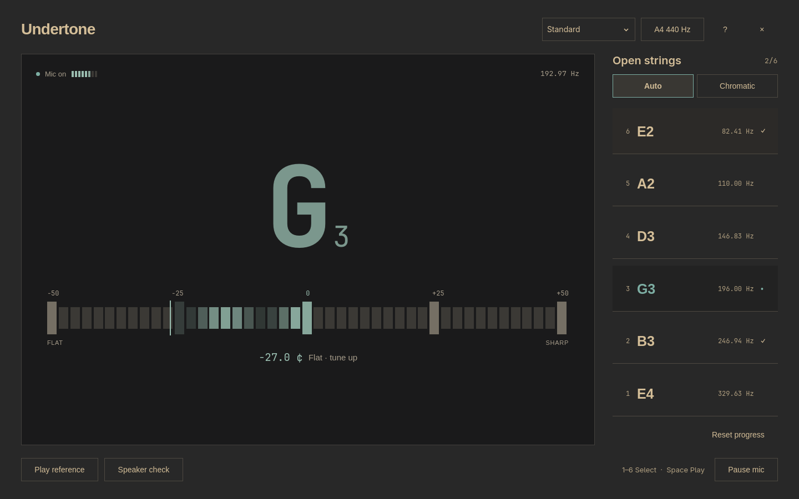
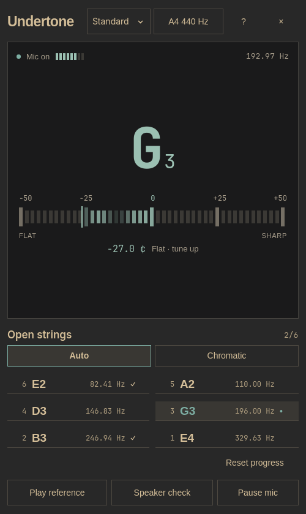

<div align="center">
  
  <h1>Undertone</h1>
  <p><strong>Hands-free acoustic guitar tuning for Linux</strong></p>
  <p>Open it, pluck any string, and follow the sound.</p>
  <a href="https://github.com/vyas-devgna/undertone/actions/workflows/test.yml"></a>
  <p><a href="#tune-by-ear">Tune by ear</a> · <a href="#omarchy-theme-integration">Omarchy themes</a> · <a href="#build-and-run">Build and run</a> · <a href="#inspirations">Inspirations</a></p>
</div>



## Tune by ear

Undertone starts listening as soon as it opens. Pluck one open string at a time, in any order. Once the pitch settles, a short cue tells you whether to tighten or loosen. You can tune the whole guitar with both hands on the instrument.

| You hear | What it means |
| --- | --- |
| Two rising notes | Tighten the string |
| Two falling notes | Loosen the string |
| One chime | The string held within ±2 cents |
| Three-note finish | All six strings have registered in tune |

A steady note stays quiet after its cue. Pluck again or adjust the pitch to hear another indication. The tuner keeps listening after the finish so you can recheck earlier strings.

## The display

The large note and segmented strobe show where the pitch sits. In a narrow window, the string targets move below the meter.

<p align="center">
  
</p>

- **Auto** follows the closest open string. Select a string to lock the target when it is far off pitch.
- **Chromatic** follows the nearest semitone for fretted notes or custom tunings.
- **Presets** include Standard, Drop D, DADGAD, Open D, Open G, and E♭ standard. A4 is adjustable from 415–466 Hz.
- **Reference tones and speaker check** let you hear a target and verify the speaker and microphone. Settings let you select the microphone or turn off cues and motion.

## Omarchy theme integration

On Omarchy, Undertone follows the active theme’s background, foreground, and accent colors. Change your desktop theme while the tuner is open and the interface updates automatically. On other Linux desktops, Undertone uses the palette shown in the screenshots. [Omarchy](https://omarchy.org/)

## Build and run

You’ll need Linux, Rust 1.85 or newer, `make`, a C++17 compiler, and Qt 6 development tools with `qmake6`, Qt Quick Controls, and Qt Multimedia. The desktop build has been verified with Qt 6.12.

```sh
git clone https://github.com/vyas-devgna/undertone.git
cd undertone
./bin/build
./build/undertone
```

Run `./bin/install` to add Undertone to your desktop launcher. The executable lands in `~/.local/bin`, which should be on your `PATH`. Use `./build/undertone --audio-check` to check the speaker and microphone from the terminal.

<details>
<summary>Keyboard shortcuts</summary>

| Key | Action |
| --- | --- |
| 1–6 | Select a guitar string |
| A / C | Switch to Auto / Chromatic |
| Space | Play or stop the reference tone |
| M | Pause or resume the microphone |
| F11 | Toggle fullscreen |
| Esc | Stop manual playback or leave fullscreen |
| ? | Show shortcuts |
| Q | Close Undertone |

</details>

## Under the hood

The Rust engine decodes microphone PCM, tracks fundamental frequency, selects string targets, and synthesizes the cues. The Qt Quick shell handles the interface and native audio devices. Microphone audio stays in memory and is processed locally.

Run `./bin/test --release -- --nocapture` to verify the engine. The suite covers 1,260 plucks across seven sample rates, dominant overtones, fragmented PCM, stereo input, cue timing, and speaker-check failure cases. [Read the engineering notes](docs/engineering.md).

## Inspirations

- **Korg Pitchblack XS** inspired the segmented meter and readable left-to-right pitch error. [Korg](https://www.korg.com/us/products/tuners/pitchblack_xs/)
- **Peterson Guided Tuning** inspired the per-string targets and progress through alternate tunings. [Peterson manual](https://www.petersontuners.com/media/pdf/Guided%20Tuning%20Manual.pdf)
- **YIN**, by Alain de Cheveigné and Hideki Kawahara, is the basis of the pitch detector. [Paper](https://doi.org/10.1121/1.1458024)
- **The University of Glasgow’s earcon research** informed the short, distinct sound patterns. [Design guidelines](https://www.dcs.gla.ac.uk/~stephen/earcon_guidelines.shtml)
